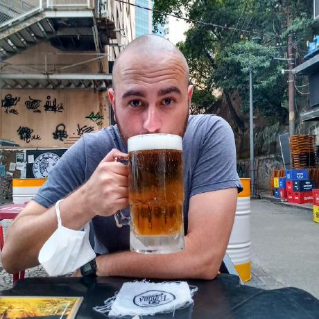

::::: {.hero}

:::: {.hero-body}

[Augusto Bopsin Borges]{.hero-name}
[Geotechnical engineer · M.Sc. · PhD candidate, PPGEC / UFRGS]{.hero-role}

I am a geotechnical engineer working at the meeting point of practice and research. In
practice, I lead the geotechnical design of critical mining structures — tailings dams,
waste piles, stockpiles and dry stacking facilities — as a senior engineer at
[DF+ Engenharia](https://dfmais.eng.br), in Belo Horizonte. In research, I build
micromechanical models for the poroelastic behavior of jointed rock masses and implement
them in finite element codes, as a doctoral candidate at the Graduate Program in Civil
Engineering ([PPGEC](https://www.ufrgs.br/ppgec/)) of the Federal University of Rio
Grande do Sul ([UFRGS](https://www.ufrgs.br)), under the supervision of
Prof. Samir Maghous.

::: {.hero-actions}
[Research](research.qmd){.btn-ab .btn-ab-primary}
[Publications](publications.qmd){.btn-ab}
[Software](software.qmd){.btn-ab}
[Blog](blog/index.qmd){.btn-ab}
:::

::: {.hero-social}
[<i class="bi bi-person-vcard"></i>ORCID](https://orcid.org/0000-0002-0521-3553)
[<i class="bi bi-mortarboard"></i>Lattes](http://lattes.cnpq.br/7249257151738108)
[<i class="bi bi-linkedin"></i>LinkedIn](https://www.linkedin.com/in/augustobopsinborges/)
[<i class="bi bi-github"></i>GitHub](https://github.com/augustobopsinborges)
[<i class="bi bi-envelope"></i>Email](mailto:augustobopsinborges@gmail.com)
:::

::::

{.hero-portrait fig-alt="Augusto Bopsin Borges"}

:::::

## Research interests

:::: {.card-grid}

::: {.ab-card}
### Micromechanics of jointed rock
Homogenization of rock masses crossed by families of joints: long joints as
interfaces, short joints through Eshelby-based schemes, and the resulting
double-porosity poroelastic coefficients.
:::

::: {.ab-card}
### Coupled poromechanics
Extensions of the double-porosity formulation to time-dependent, thermal and
chemical couplings, to partially saturated media and to elastoplastic constituents.
:::

::: {.ab-card}
### Finite element computation
Three-dimensional finite element codes for Biot poroelasticity with one or two
porous systems, from the variational formulation to the solver and the
pre- and post-processing chain.
:::

::: {.ab-card}
### Field-scale applications
Deep tunnels and reservoirs in fractured rock masses, where drainage,
settlement and pressure changes are governed by the interplay between joints
and matrix.
:::

::::

::: {.section-actions}
[More on the research →](research.qmd){.btn-ab}
:::

## Engineering practice

:::: {.card-grid}

::: {.ab-card}
### Tailings storage facilities
Design, raising and safety of tailings dams, from conceptual to executive phases;
monitoring, instrumentation and performance reporting as part of Engineer of Record
teams.
:::

::: {.ab-card}
### Waste piles and dry stacking
Soil and rock waste facilities, stockpiles and filtered tailings stacks for gold and
iron mining, for throughputs up to 11 Mt/y and stack heights above 300 m.
:::

::: {.ab-card}
### Foundations and slopes
Foundation systems for large industrial plants, including vibrating structures;
stability of natural and engineered slopes; seepage and geotechnical risk assessment.
:::

::: {.ab-card}
### Computational geotechnics
Finite element and limit equilibrium modeling, constitutive modeling and
multivariate analysis of geotechnical data, in Python and Fortran.
:::

::::

::: {.section-actions}
[Background and experience →](about.qmd){.btn-ab}
:::

## From the blog

Notes on poromechanics, numerical methods and the tools around them.
Every post is listed on the [blog page](blog/index.qmd), which also carries an
[RSS feed](blog/index.xml).

::: {#recent-posts}
:::

::: {.section-actions}
[All posts →](blog/index.qmd){.btn-ab}
:::

## Recent publications

::: {.pub-list}
- [A micromechanics-based approach to the poroelastic behavior of a double-porosity jointed rock medium]{.pub-title}
  **Borges, A. B.**, Maghous, S. [Submitted to *Computers and Geotechnics*, 2026.]{.pub-venue} [Under review]{.pub-status}
- [Micromechanical approach to the effective poroelastic behavior of jointed rock masses under one-dimensional consolidation and finite element implementation]{.pub-title}
  **Borges, A. B.**, Maghous, S. [XLIII Ibero-Latin American Congress on Computational Methods in Engineering (CILAMCE 2022), Foz do Iguaçu, 2022.]{.pub-venue}
- [A simplified numerical approach to the evaluation of residual shaft friction induced by concrete curing in drilled shafts on granular soils]{.pub-title}
  **Borges, A. B.**, Linn, R. V., Schnaid, F., Maghous, S. [*Revista IBRACON de Estruturas e Materiais*, 13(5), e13505, 2020.]{.pub-venue}
:::

::: {.section-actions}
[All publications →](publications.qmd){.btn-ab}
:::

## Software

I develop finite element programs for poroelastic analysis — [GEOMECH3D](software.qmd#geomech3d)
for single-porosity Biot media and [GEOMECH3D-DP](software.qmd#geomech3d-dp) for the
double-porosity formulation — together with their GiD® pre- and post-processing problem
types, and [GeoMicroLab](software.qmd#geomicrolab), a Python library for implementing and
verifying micromechanical models of porous and fractured materials.

::: {.section-actions}
[Browse the software →](software.qmd){.btn-ab}
:::
